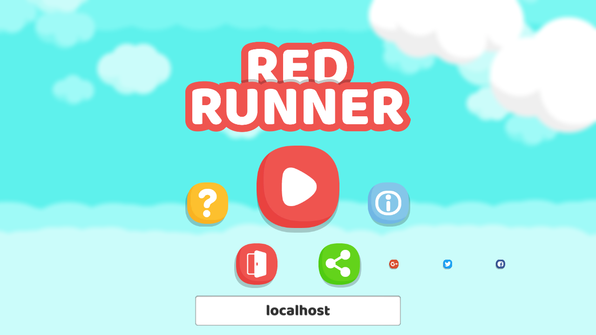

# Join a server

This chapter turns the scene character into a network prefab, lets the game run as a dedicated server, a host or a client, and spawns a character for every client that joins. Characters stand at the start of the level; the next chapter makes them move.

## Make the character a network prefab

Red Runner already has the character as a prefab, `Assets/Prefabs/RedRunner.prefab`, identical to the `RedRunner` object in `Play.unity`. Open the prefab and add three components to its root:

1. `NetworkObject`, which gives every instance an object id on the network.
2. `NetworkTransform`, which sends the server's position to the clients. Turn Sync Rotation off, because the character's `Rigidbody2D` freezes rotation, and turn Sync Scale on: `RedCharacter` faces left or right by setting `localScale.x` to -1 or 1.
3. `NetworkPlayer`, a behaviour written below.

Save the prefab and choose Tools > Fomoxa > Assign Prefab Ids. The package gives every prefab with a `NetworkObject` a prefab id and lists it in `Generated/FomoxaPrefabList.asset`, which a server and a client use to agree on what to spawn. A player build runs the same step before it builds.

Then delete the `RedRunner` object from `Play.unity`. Characters now come from the server. Three scene objects pointed at it: the Game Manager's Main Character, the Terrain Generator's Character and the camera's Followee. They are empty now, so the code that reads them needs a null check.

## Let the game run without a scene character

`GameManager.Start` and `GameManager.Update` only touch the main character when there is one:

```csharp
private void Start()
{
    if (m_MainCharacter != null)
    {
        m_MainCharacter.IsDead.AddEventAndFire(UpdateDeathEvent, this);
        m_StartScoreX = m_MainCharacter.transform.position.x;
    }
    Init();
}
```

`CameraController.Follow` returns when it has nothing to follow, and gets an overload that sets what to follow, used by the next chapter:

```csharp
public void Follow ( Transform followee )
{
	m_Followee = followee;
}
```

```csharp
public void Follow ()
{
	if ( m_Followee == null )
	{
		return;
	}
```

`GameManager.StopGame` and `ResumeGame` used to set `Time.timeScale` to 0 and 1, which paused the whole game behind the start screen and the pause screen. An online game cannot pause: the server keeps running and other players keep moving. Both methods now only set the flag that the rest of the game reads:

```csharp
public void StopGame()
{
    m_GameRunning = false;
}
```

```csharp
public void ResumeGame()
{
    m_GameRunning = true;
}
```

`RedCharacter.Update` stops reading the keyboard. It used to call `Move` and `Jump` from `CrossPlatformInputManager` and add a roll force, which would move every character in the process from one keyboard. The next chapter sends the input through the network instead. The guard and punch actions (`Guard`, `Fire`) are left out of the online game.

## Configure the NetworkManager

Select `Network Manager` in `Play.unity` and change three fields:

| Field | Value | Why |
|---|---|---|
| Tick Rate | 50 | The project's fixed timestep is 0.02 s. At 50 ticks per second the network simulation steps physics as often as the single-player game did. |
| Simulate Physics | on | The manager steps 2D physics once per tick. On a client, a networked `Rigidbody2D` that the client does not predict becomes a kinematic body that follows its `NetworkTransform`, so the client's physics no longer fights the server's positions. |
| Max Reconnect Retries | 3 | The default, -1, retries forever. With 3, a client that cannot reach the server gives up and the game goes back to the start screen. |

Then drag `Generated/FomoxaPrefabList.asset` into Collected Prefabs and `Generated/FomoxaSceneList.asset` into Collected Scenes.

> The package also assigns both lists when Unity prepares a scene for Play Mode, but in the Editor that happens after `NetworkManager.Awake` has registered the prefabs, so spawning fails with `prefab id 0x... of RedRunner(Clone) is not registered`. In a player build the lists are assigned during the build and the problem does not occur. Assigning the lists in the scene works for both.

## Start a server, a host or a client

`NetworkGame` sits next to the `NetworkManager` and holds the game's networking decisions: how to start, where to spawn a player and which player is the local one.

```csharp
using System;
using Fomoxa.Unity;
using Fomoxa.Unity.Sessions;
using UnityEngine;

namespace RedRunner.Networking
{
    public sealed class NetworkGame : MonoBehaviour
    {
        public const ushort DefaultPort = 7777;

        [SerializeField]
        private NetworkManager m_Manager;

        [SerializeField]
        private NetworkObject m_PlayerPrefab;

        [SerializeField]
        private Vector2 m_SpawnPoint = new Vector2(7.24f, 12.59f);

        [SerializeField]
        private ushort m_Port = DefaultPort;

        [SerializeField]
        private int m_ServerFrameRate = 60;

        public event Action<NetworkPlayer> LocalPlayerChanged;

        public event Action<ConnectionState> ClientStateChanged;

        public NetworkManager Manager => m_Manager;

        public NetworkPlayer LocalPlayer { get; private set; }

        public Vector2 SpawnPoint => m_SpawnPoint;

        public bool IsServer => m_Manager.ServerManager.State == ServerState.Started;

        private void Start()
        {
            m_Manager.ServerManager.OnRemoteConnectionState += OnRemoteConnectionState;
            m_Manager.ClientManager.OnClientConnectionState += OnClientConnectionState;
            string[] arguments = Environment.GetCommandLineArgs();
            ushort port = ReadPort(arguments);
            if (Array.IndexOf(arguments, "-server") >= 0)
            {
                Application.targetFrameRate = m_ServerFrameRate;
                StartServer(port);
            }
            else if (Array.IndexOf(arguments, "-host") >= 0)
            {
                Host(port);
            }
        }

        private void OnDestroy()
        {
            if (m_Manager != null && m_Manager.ServerManager != null)
            {
                m_Manager.ServerManager.OnRemoteConnectionState -= OnRemoteConnectionState;
                m_Manager.ClientManager.OnClientConnectionState -= OnClientConnectionState;
            }
        }

        public void StartServer(ushort port)
        {
            m_Manager.ServerManager.StartConnection(port);
            Debug.Log($"[RedRunner] server listening on UDP port {m_Manager.ServerManager.Port}");
        }

        public void Host(ushort port)
        {
            StartServer(port);
            m_Manager.ClientManager.StartConnection("localhost", m_Manager.ServerManager.Port);
        }

        public void Join(string address)
        {
            Join(address, m_Port);
        }

        public void Join(string address, ushort port)
        {
            m_Manager.ClientManager.StartConnection(string.IsNullOrWhiteSpace(address) ? "localhost" : address.Trim(), port);
        }

        public void Leave()
        {
            m_Manager.ClientManager.StopConnection();
            if (IsServer)
            {
                m_Manager.ServerManager.StopConnection();
            }
        }

        internal void SetLocalPlayer(NetworkPlayer player)
        {
            LocalPlayer = player;
            LocalPlayerChanged?.Invoke(player);
        }

        internal void ClearLocalPlayer(NetworkPlayer player)
        {
            if (LocalPlayer == player)
            {
                SetLocalPlayer(null);
            }
        }

        private void OnRemoteConnectionState(ConnectionStateArgs args)
        {
            if (args.State != ConnectionState.Started)
            {
                return;
            }

            NetworkObject player = Instantiate(m_PlayerPrefab, m_SpawnPoint, Quaternion.identity);
            m_Manager.ServerManager.Spawn(player, args.PeerId);
            Debug.Log($"[RedRunner] spawned a player for peer {args.PeerId} at {m_SpawnPoint}");
        }

        private void OnClientConnectionState(ConnectionStateArgs args)
        {
            ClientStateChanged?.Invoke(args.State);
        }

        private ushort ReadPort(string[] arguments)
        {
            int index = Array.IndexOf(arguments, "-port");
            if (index >= 0 && index + 1 < arguments.Length && ushort.TryParse(arguments[index + 1], out ushort port))
            {
                return port;
            }

            return m_Port;
        }
    }
}
```

The server spawns a character as soon as a peer reaches `ConnectionState.Started`, with that peer as the owner. The level already exists at that point, because `NetworkLevel` builds it when the server starts. When the peer leaves, the package despawns the character, since `NetworkObject` despawns objects with their owner by default.

`Start` reads the command line. `-server` starts a dedicated server and caps the frame rate, because a batch mode player otherwise runs frames as fast as the CPU allows. `-host` starts a server and connects a client inside the same process. `-port` changes the UDP port, 7777 by default.

`NetworkPlayer` tells `NetworkGame` which character belongs to this client:

```csharp
using Fomoxa.Unity;
using UnityEngine;

namespace RedRunner.Networking
{
    public sealed class NetworkPlayer : NetworkBehaviour
    {
        private NetworkGame m_Game;

        public override void OnStartClient()
        {
            if (NetworkObject.IsOwner)
            {
                m_Game = FindFirstObjectByType<NetworkGame>();
                m_Game?.SetLocalPlayer(this);
            }
        }

        public override void OnStopClient()
        {
            m_Game?.ClearLocalPlayer(this);
            m_Game = null;
        }
    }
}
```

`NetworkObject.IsOwner` is already valid in `OnStartClient`. On the server and on other clients the character is not owned, so only the owner's client reports it.

Add `NetworkGame` to the `Network Manager` object, drag the `NetworkManager` into its Manager field and `RedRunner.prefab` into Player Prefab. The default spawn point, (7.24, 12.59), is where the scene character stood: above the start block, which `Build` places at x = 0.

## Add the address field

Under `Canvas/Start Screen`, add GameObject > UI > Legacy > Input Field and name it `Address Field`. Place it below the row of small buttons (position 0, -222, size 320 × 48), set its text to `localhost` and its placeholder to `Server address`. Give both texts the game's font (`Baloo-Regular`) at size 24, centred, with Vertical Overflow set to Overflow: Baloo's line height is larger than the text area of a default input field, and with Truncate the text does not show at all.



`StartScreen` gets the field and the `NetworkGame`. The Play button joins the address before it opens the in-game screen, and a connection that stops while the game runs brings the start screen back:

```csharp
private void Start()
{
    PlayButton.SetButtonAction(() =>
    {
        var uiManager = UIManager.Singleton;
        var InGameScreen = uiManager.UISCREENS.Find(el => el.ScreenInfo == UIScreenInfo.IN_GAME_SCREEN);
        if (InGameScreen != null)
        {
            Network.Join(AddressField.text);
            uiManager.OpenScreen(InGameScreen);
            GameManager.Singleton.StartGame();
        }
    });
    Network.ClientStateChanged += state =>
    {
        if (state == ConnectionState.Stopped && GameManager.Singleton.gameStarted)
        {
            GameManager.Singleton.EndGame();
            UIManager.Singleton.OpenScreen(this);
        }
    };

    ExitButton.SetButtonAction(() =>
    {
        GameManager.Singleton.ExitGame();
    });
}
```

`PauseScreen` gets a Network field too, and its Home button calls `Network.Leave()` before `GameManager.Init()`.

Drag `Address Field` and `Network Manager` into the new fields of Start Screen, and `Network Manager` into the Network field of Pause Screen.

## Run it

Build a Windows player with `Play.unity` as its only scene. Start the server from a terminal:

```
RedRunner.exe -batchmode -nographics -server -port 7777 -logFile server.log
```

The log shows the seed, the port and every spawn:

```
[RedRunner] level seed 1535992127
[RedRunner] server listening on UDP port 7777
[RedRunner] spawned a player for peer 1 at (7.24, 12.59)
```

Press Play in the Editor, keep `localhost` in the address field and click Play. The client builds the level from the server's seed and the character drops onto the start block. Start more clients from the build to see more characters; they stand in the same place and pass through each other, because the 2D layer collision matrix already turns off `Characters` against `Characters`.

To try everything in one process, start the build with `-host`.

This repository checks both cases from WSL:

```bash
./Tools/unity-windows.sh play RedRunner.PortChecks.PortPlay.Host
./Tools/unity-windows.sh run RedRunner.PortChecks.PortBuild.Player
./Tools/unity-windows.sh play-server RedRunner.PortChecks.PortPlay.Join
```

The second check runs the built player as a server in its own process and joins it from the Editor. It passes when the client's seed matches the seed in the server log, the client has built all 22 blocks, and the client's own character stands on the start block.
