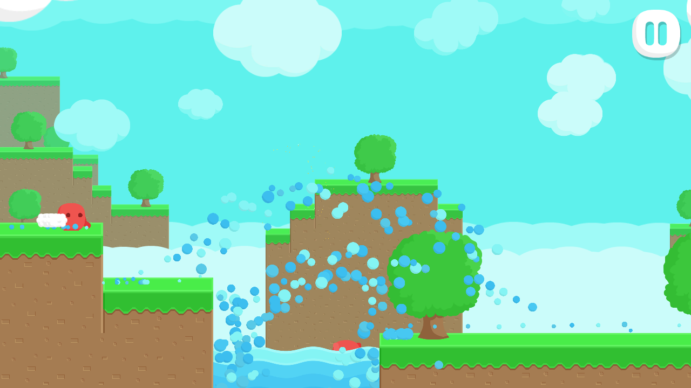

# Death, respawn and the end of the level

In the single-player game, the saw, the spikes, the water and the mace kill the character from their collision callbacks, a fall below the level kills it in `RedCharacter.Update`, and the game shows the end screen with the score. Online, only the server decides that a character dies. A client predicts its own character, so a collision on the client can be wrong: the server may have seen the character jump a tick earlier. This chapter moves every death to the server, sends it to the clients as state, respawns the character at the start, sends a player who reaches the end block back to the start, keeps coins and chests on each client, and removes the score.

## Name the cause of a death

A client needs to know how a character died to show the right effect, so `Die` takes a cause:

```csharp
namespace RedRunner.Characters
{

	public enum DeathCause
	{
		Fall,
		Saw,
		Spike,
		Water,
		Mace
	}

}
```

`Character` replaces `Die ( bool blood )` with `Die ( DeathCause cause )` and gets three properties:

```csharp
public virtual DeathCause DeathCause { get; protected set; }

public virtual bool DecidesDeath { get; set; } = true;

public virtual bool CollectsItems { get; set; } = true;
```

`DecidesDeath` tells the enemies whether their collision may kill this character in this process. `CollectsItems` tells coins and chests whether this character picks them up. Both default to true, which is the single-player behaviour; `NetworkPlayer` sets them when the character spawns.

`RedCharacter.Die` now plays every effect of a death itself, chosen by the cause, so the same call shows the death on the server and on a client:

```csharp
public override void Die ( DeathCause cause )
{
	if ( !IsDead.Value )
	{
		DeathCause = cause;
              IsDead.Value = true;
		m_Skeleton.SetActive ( true, m_Rigidbody2D.linearVelocity );
		if ( cause == DeathCause.Saw || cause == DeathCause.Spike || cause == DeathCause.Mace )
		{
			ParticleSystem particle = Instantiate<ParticleSystem> (
				                          m_BloodParticleSystem,
				                          transform.position,
				                          Quaternion.identity );
			Destroy ( particle.gameObject, particle.main.duration );
		}
		if ( cause == DeathCause.Spike || cause == DeathCause.Mace )
		{
			AudioManager.Singleton.PlaySpikeSound ( transform.position );
		}
		if ( cause == DeathCause.Water )
		{
			Vector3 spawnPosition = transform.position;
			spawnPosition.y += -1f;
			ParticleSystem particle = Instantiate<ParticleSystem> ( m_WaterParticleSystem, spawnPosition, Quaternion.identity );
			Destroy ( particle.gameObject, particle.main.duration );
			AudioManager.Singleton.PlayWaterSplashSound ( transform.position );
		}
		if ( CameraController.Singleton != null && CameraController.Singleton.Followee == transform )
		{
			CameraController.Singleton.fastMove = true;
		}
	}
}
```

The blood, the spike sound and the water splash used to be played by the enemy that killed the character. The camera's fast move now only applies to the character the camera follows; `CameraController` exposes `Followee` for that. The fall check (`transform.position.y < 0f`) leaves `RedCharacter.Update`; the server does it.

## Let only the server kill

Each enemy checks `DecidesDeath` before it kills and passes its cause. The saw:

```csharp
void OnCollisionEnter2D (Collision2D collision2D)
{
	Character character = collision2D.collider.GetComponent<Character> ();
	if (character != null && character.DecidesDeath) {
		Kill (character);
	}
}
```

The spike, the water and the mace get the same check. The mace keeps its own slam, squash and smile, which now run only where the kill happens.

## Keep the death in the player's state

The server's decision travels as state on `NetworkPlayer`, like the seed on `NetworkLevel`:

```csharp
using Fomoxa;
using Fomoxa.Unity;

namespace RedRunner.Networking.Models
{
    [Network]
    [Codec("net")]
    [NetworkChannel("net", Channel.ReliableOrdered)]
    public class PlayerState
    {
        [Network("bool")]
        [Codec("net")]
        public bool Dead { get; set; }

        [Network("u8")]
        [Codec("net")]
        public byte Cause { get; set; }
    }
}
```

`NetworkPlayer` registers it next to its input, and sets the two character flags when the character spawns:

```csharp
protected override void OnRegisterState(NetworkState state)
{
    state.Use(PlayerStateNetAdapter.Instance, m_State, previous => ShowState());
}
```

```csharp
public override void OnStartServer()
{
    m_Character.DecidesDeath = true;
    m_Character.CollectsItems = false;
    m_Game.Manager.TimeManager.OnTick += ServerTick;
}
```

```csharp
public override void OnStartClient()
{
    m_Character.CollectsItems = NetworkObject.IsOwner;
    if (!m_Game.IsServer)
    {
        m_Character.DecidesDeath = false;
        ShowState();
    }

    if (NetworkObject.IsOwner)
    {
        m_Game.SetLocalPlayer(this);
    }
}
```

On the server the character decides its death and collects nothing. On a client only the owner collects; no character decides its death, so an enemy touched by a predicted or interpolated character does nothing. In host mode the server sets the flags first and the owner's client then turns collecting on, so the host's own character does both.

The state callback receives the previous value; `m_State` already holds the new one. `ShowState` brings the character in line with `m_State`. It does nothing on the server, which is where the state comes from:

```csharp
private void ShowState()
{
    if (m_Game.IsServer)
    {
        return;
    }

    if (m_State.Dead && !m_Character.IsDead.Value)
    {
        m_Character.Die((DeathCause)m_State.Cause);
    }
    else if (!m_State.Dead && m_Character.IsDead.Value)
    {
        m_Character.Reset();
    }
}
```

## Decide on the server after each tick

`OnStartServer` subscribes to `TimeManager.OnTick`, which the package raises after it has stepped the physics of a tick. By then the enemies' collision callbacks for that tick have run:

```csharp
private void ServerTick()
{
    TimeManager time = m_Game.Manager.TimeManager;
    if (m_State.Dead)
    {
        if (time.Tick >= m_RespawnTick)
        {
            Respawn();
        }

        return;
    }

    if (!m_Character.IsDead.Value && transform.position.y < 0f)
    {
        m_Character.Die(DeathCause.Fall);
    }

    if (m_Character.IsDead.Value)
    {
        m_State.Dead = true;
        m_State.Cause = (byte)m_Character.DeathCause;
        m_RespawnTick = time.Tick + (uint)Mathf.CeilToInt(m_RespawnDelay * time.TickRate);
        Debug.Log($"[RedRunner] player {NetworkObject.OwnerId} died: {m_Character.DeathCause}");
    }
    else if (TerrainGenerator.Singleton.IsBuilt && transform.position.x >= TerrainGenerator.Singleton.EndX)
    {
        Debug.Log($"[RedRunner] player {NetworkObject.OwnerId} reached the end block");
        Respawn();
    }
}
```

A dead character waits two seconds, 100 ticks at 50 ticks per second, while the client shows the skeleton. A character that passes the start of the end block goes straight back to the start.

```csharp
private void Respawn()
{
    m_Character.Reset();
    PhysicsBody2D body = NetworkObject.Body2D;
    BodyState2D state = body.State;
    state.Position = new System.Numerics.Vector2(m_Game.SpawnPoint.x, m_Game.SpawnPoint.y);
    state.Velocity = System.Numerics.Vector2.Zero;
    body.State = state;
    m_NetworkTransform.Teleport();
    m_Character.RunSmoothVelocity = 0f;
    m_State.Dead = false;
    m_State.Cause = 0;
}
```

`Reset` revives the character and turns its `Rigidbody2D` back on, then the body moves to the spawn point. `NetworkPlayer.Awake` keeps the character's `NetworkTransform` in `m_NetworkTransform`, and `NetworkTransform.Teleport()` tells the other clients that this move is a jump, so they place the character at the start instead of interpolating it across the level; the chapter on two clients shows how that was found. The owner's client sees the jump in position as a prediction error and corrects to it, the same way it corrects any other difference from the server.

## Keep coins and chests on each client

Coins and chests react only to a character that collects items:

```csharp
public override void OnTriggerEnter2D (Collider2D other)
{
	Character character = other.GetComponent<Character> ();
	if (m_UseOnTriggerEnter2D && character != null && character.CollectsItems) {
		Collect ();
	}
}
```

Each client collects the coins its own character touches. Nobody else sees them disappear, and the server ignores them.

## Remove the score

`GameManager` no longer loads or saves the coin count, the scores or the audio setting with SaveGameFree; the counters start at zero in every session. There is no main character any more, so the score and the end screen are never used. In `Play.unity`, deactivate `Coin Panel`, `High Score Text` and `Score Text` under `Canvas/In-Game Screen`.

## Leave the start screen cleanly

The start screen's handler for a stopped connection is now a method that `OnDestroy` unsubscribes. Without that, quitting while connected let the handler run after Unity had destroyed the screen's `Animator`:

```csharp
private void Network_ClientStateChanged(ConnectionState state)
{
    if (state == ConnectionState.Stopped && GameManager.Singleton.gameStarted)
    {
        GameManager.Singleton.EndGame();
        UIManager.Singleton.OpenScreen(this);
    }
}
```

## Check it

Join a server and run into the water. The server's log says why the character died:

```
[RedRunner] player 1 died: Water
```

The skeleton drops, and two seconds later the character stands at the start again.



This repository checks it in two ways. `./Tools/unity-windows.sh play RedRunner.PortChecks.PortPlay.HostLife` starts a host, moves the host's character below the level and checks that it dies of `Fall`, stays dead for the delay and respawns at the start, then moves it onto the end block and checks that it comes back to the start. `./Tools/unity-windows.sh play-server RedRunner.PortChecks.PortPlay.Life` joins a server process, runs right and jumps until the character dies, and checks that the client shows the death only with the server's state, then shows the respawn. In one run the character died in the water 3.1 seconds after starting, respawned at the start and had collected one coin.
